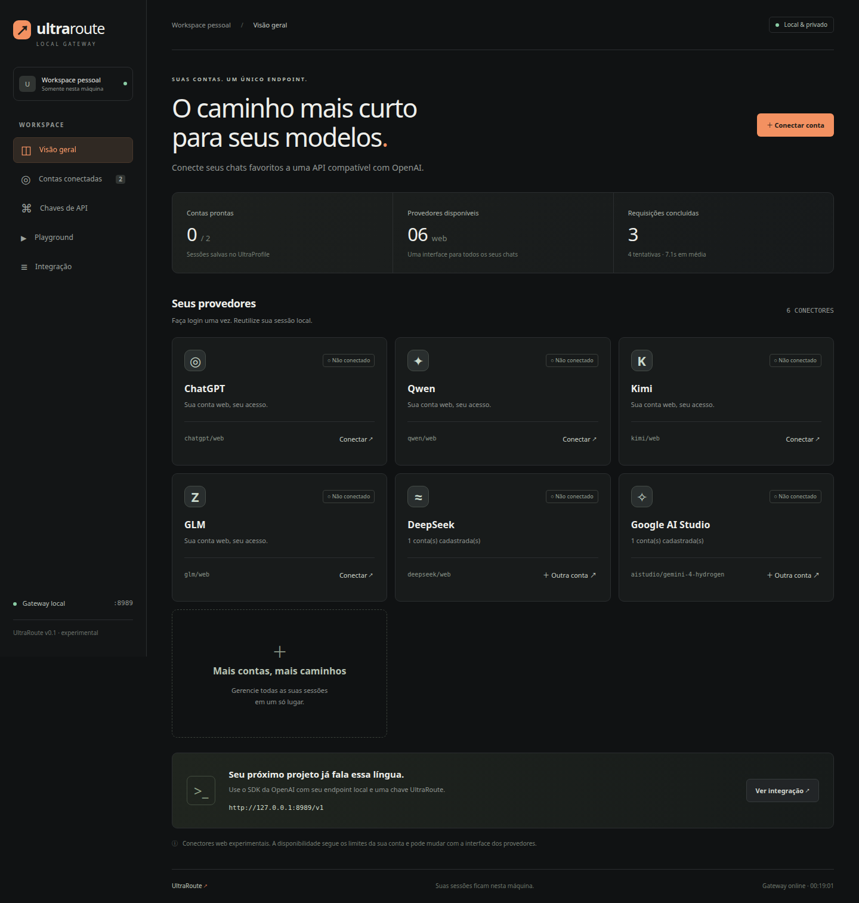

<div align="center">

# UltraRoute ↗

### Your AI accounts. One local API.

Use your web chat accounts from an OpenAI-compatible endpoint.<br>
Sign in yourself. Keep your sessions on your machine. Stream responses to your apps.

[Get started](#install) · [Connect your accounts](#connect-your-accounts) · [API](#use-the-api) · [Limitations](#what-to-expect)



</div>

## What is UltraRoute?

UltraRoute is a personal gateway that connects your browser sessions to a familiar API. It opens your installed Chrome or Chromium, lets you sign in manually, and uses Playwright over a local connection **after you confirm access**.

- **One endpoint:** `http://127.0.0.1:8989/v1`
- **One dashboard:** `http://127.0.0.1:8989`
- **Persistent sessions:** your accounts stay in a dedicated **UltraProfile**, separate from your everyday browser profile.
- **Live streaming:** response updates are forwarded while the provider generates them.
- **Local API keys:** create and revoke access from the dashboard.
- **Browser recovery:** closed tabs are recreated; a managed browser can reopen with its saved session.

> **Early-stage project.** Web adapters depend on provider interfaces and account access. They can break when a site changes. This is a text-generation gateway, not a complete implementation of the OpenAI platform.

## Install

Use a desktop session with an internet connection. The installers set up **uv**, a managed **Python 3.13**, and UltraRoute in an isolated environment. Git and a preinstalled Python are not required. The server starts in the current terminal; press **Ctrl+C** to stop it.

### Linux

```bash
curl -fsSL https://raw.githubusercontent.com/wanbnn/ultraroute/main/install.sh | bash
```

### Windows · PowerShell

```powershell
irm https://raw.githubusercontent.com/wanbnn/ultraroute/main/install.ps1 | iex
```

Prefer to inspect the installer first? Download [install.sh](install.sh) or [install.ps1](install.ps1), review it, then run it locally. Use `bash install.sh --no-start` or `./install.ps1 -NoStart` to install without launching.

**Next time, just run:**

```text
ultraroute
```

Then open **http://127.0.0.1:8989**. If the command is missing, restart your terminal or run `uv tool update-shell`.

### Browser setup

UltraRoute reuses an installed Chrome or Chromium:

| Platform | Discovery | If no browser is found |
| --- | --- | --- |
| Linux | Native Chrome/Chromium, Flatpak, Snap | Installs Chromium through an available Flatpak or Snap installation |
| Windows | Chrome/Chromium in standard installation locations | Attempts Google Chrome installation through WinGet |

A package manager may need permission to install a browser. If installation fails or no supported manager exists, install Chrome/Chromium yourself and retry. UltraRoute does not change system sandbox settings.

Linux, including Chromium Flatpak, has been exercised locally. Windows paths and installer logic are covered by platform-independent tests; a real Windows installation still needs verification. The dashboard is currently in Portuguese.

## Connect your accounts

1. Open the dashboard and click **Conectar conta** (Connect account).
2. Choose a provider and name the account.
3. Sign in directly in the browser window. Complete any consent screen, CAPTCHA, or two-factor challenge yourself.
4. Click **Já entrei · conectar** (I've signed in · connect) to authorize automation.
5. Create an API key under **Chaves de API**. Copy it: the secret is shown only once.
6. Try a message in the **Playground**, or connect your own app.

Existing Google sign-ins in UltraProfile are shared with Google AI Studio. Different providers use separate tabs in the same profile. A second account for the **same** provider gets a separate profile so its cookies do not collide.

Website notifications are blocked in UltraRoute profiles. API request tabs are created with background/no-focus options to avoid asking the desktop to activate Chromium; desktop notification behavior can vary by window manager.

### Available connectors

| Provider | API model ID | Website |
| --- | --- | --- |
| ChatGPT | `chatgpt/web` | [chatgpt.com](https://chatgpt.com/) |
| Qwen | `qwen/web` | [chat.qwen.ai](https://chat.qwen.ai/) |
| Kimi | `kimi/web` | [kimi.com](https://www.kimi.com/en) |
| GLM | `glm/web` | [z.ai/chat](https://z.ai/chat) |
| DeepSeek | `deepseek/web` | [chat.deepseek.com](https://chat.deepseek.com/) |
| Google AI Studio | `aistudio/gemini-4-hydrogen` | [Open the requested model](https://aistudio.google.com/prompts/new_chat?model=gemini-4-hydrogen) |

All adapters are experimental. The AI Studio URL requests `gemini-4-hydrogen`; access and the model actually selected remain controlled by Google. Other connector IDs represent a web provider, not a guaranteed underlying model version. Opening a tab does not automatically select an arbitrary model variant.

## Use the API

Install the OpenAI SDK in your own app:

```bash
pip install openai
```

```python
from openai import OpenAI

client = OpenAI(
    base_url="http://127.0.0.1:8989/v1",
    api_key="ur_YOUR_KEY",
)

print(client.models.list())

stream = client.chat.completions.create(
    model="aistudio/gemini-4-hydrogen",
    messages=[{"role": "user", "content": "Explain what an API is in two sentences."}],
    stream=True,
)
for chunk in stream:
    if chunk.choices:
        print(chunk.choices[0].delta.content or "", end="", flush=True)
```

Remove `stream=True` for a normal JSON response. All `/v1/*` routes require `Authorization: Bearer ur_YOUR_KEY`.

| Method | Endpoint | Support |
| --- | --- | --- |
| GET | `/v1/models` | Lists connectors, including those without a connected account |
| GET | `/v1/models/{id}` | Retrieves connector metadata |
| POST | `/v1/chat/completions` | Text messages; JSON or SSE |
| POST | `/v1/completions` | One text prompt; JSON or SSE |
| POST | `/v1/responses` | Text input/messages; JSON or SSE; `store=false` |
| GET | `/health` | Unauthenticated process health |

<details>
<summary>Responses API example</summary>

```python
with client.responses.stream(
    model="aistudio/gemini-4-hydrogen",
    input="Explain what an API is in two sentences.",
    store=False,
) as stream:
    for event in stream:
        if event.type == "response.output_text.delta":
            print(event.delta, end="", flush=True)
```

</details>

### How streaming works

Playwright observes the rendered answer every 250 ms and forwards new text immediately. UltraRoute does **not** wait for the entire answer and then pretend to stream it. Updates follow the website's rendering, not the provider's original network events, so one event does not necessarily equal one token.

AI Studio answer extraction excludes its timer, loading labels, and thought panels. A live AI Studio API test completed with seven content deltas; the first text took about 125 seconds in that run. Provider latency and account limits still apply.

Failures before output return an HTTP error. Failures after output are sent in the stream. Closing the client connection cleans up its request tab and releases the account. A message already sent to a provider is never automatically resent during recovery.

## What to expect

**Supported:** text-only conversations, incremental SSE, one request at a time per account, routing to a free account of the requested provider, and local session recovery.

**Not supported:** tool/function calling, images, audio, embeddings, files, batches, structured output, logprobs, or stored/resumable Responses. Unsupported endpoints return `501`; unavailable controls such as `temperature` or `max_tokens` return `400`. As a compatibility exception, `max_output_tokens` is accepted and ignored on all three generation endpoints; it does not limit or truncate the response.

System/developer messages and history are serialized as text into a **new web conversation**. They do not become native system roles. These conversations may remain in the provider's history. Token counts and costs are not supplied by the websites, so `usage` is `null`.

If every account for a provider is busy, the API returns `429` with `Retry-After: 5`. Without a ready account, it returns `503`. A provider can refuse access, require another login, or limit usage independently of UltraRoute.

## Your data stays local

- The server binds to **127.0.0.1**, not your network interface.
- Browser debugging uses loopback, with primary profile port **9222**.
- API keys are stored as hashes; full keys are not persisted.
- Request metrics store status and timing, not prompts or answers.
- Cookies live in the browser profile and are credentials. Never share or commit that directory.
- The dashboard is intended for one local workspace, not a public multi-user deployment.

Installed app data:

| Platform | State | Primary browser profile |
| --- | --- | --- |
| Linux | `~/.local/share/ultraroute/state` | `~/.local/share/ultraroute/ultraprofile` |
| Windows | `%LOCALAPPDATA%\UltraRoute\state` | `%LOCALAPPDATA%\UltraRoute\ultraprofile` |

Linux respects `XDG_DATA_HOME`; Snap uses `~/snap/chromium/common/ultraroute` for browser profiles. A source checkout keeps application state in `.data/`. **Disconnect** revokes automatic recovery without deleting cookies; deleting the last account using a profile requires closing its browser first.

## Configuration

| Variable | Purpose |
| --- | --- |
| `ULTRAROUTE_PORT` | Dashboard/API port; default `8989` |
| `ULTRAROUTE_DATA_DIR` | Override the state directory |
| `ULTRAROUTE_BROWSER` | Full path to a native Chrome/Chromium executable |
| `ULTRAROUTE_SYSTEM_BROWSER` | Prefer a detected browser ID, e.g. `flatpak:org.chromium.Chromium` |

If you change the port, use the matching URL in your client. The dashboard currently displays the default port in its integration examples.

## Development

```bash
git clone https://github.com/wanbnn/ultraroute.git
cd ultraroute
uv sync --locked
uv run playwright install chromium
uv run pytest -q
uv run ultraroute
```

The Playwright Chromium download is for local browser tests; normal account login uses your installed browser.

## Update or uninstall

Rerun the installer to update. To uninstall the command:

```bash
uv tool uninstall ultraroute
```

Uninstalling does not delete your state or browser sessions. Remove the relevant directories yourself if you want to erase them.

## License

[MIT](LICENSE) · Built for personal, local use with accounts you are authorized to access.
